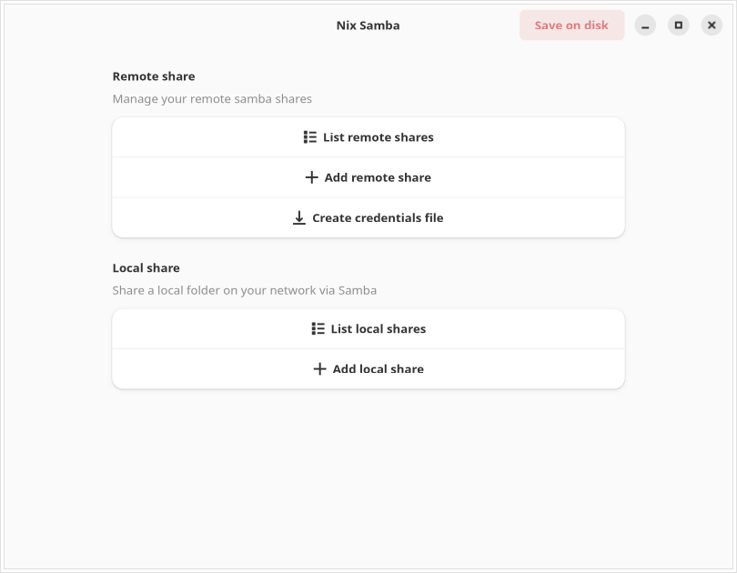
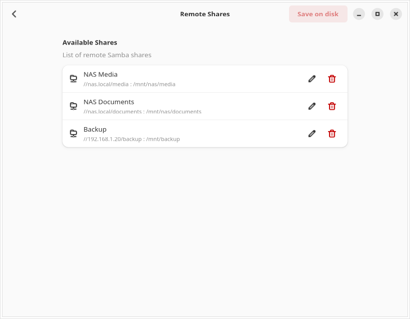
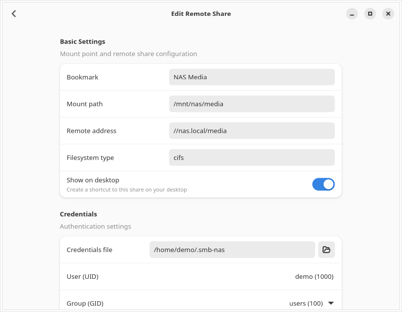
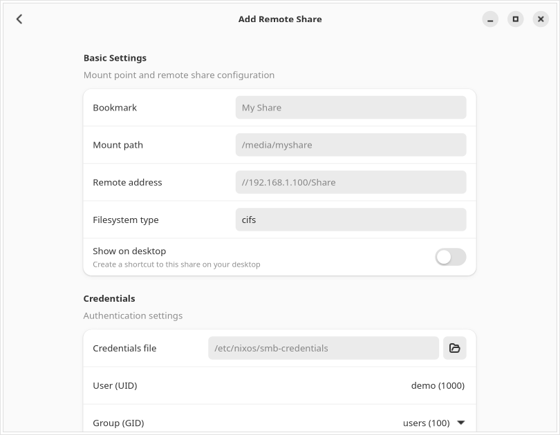
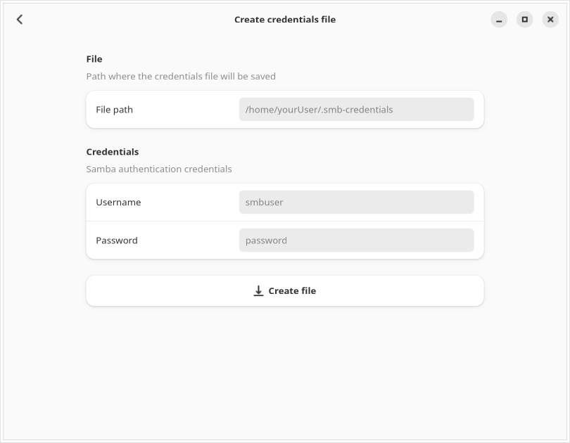
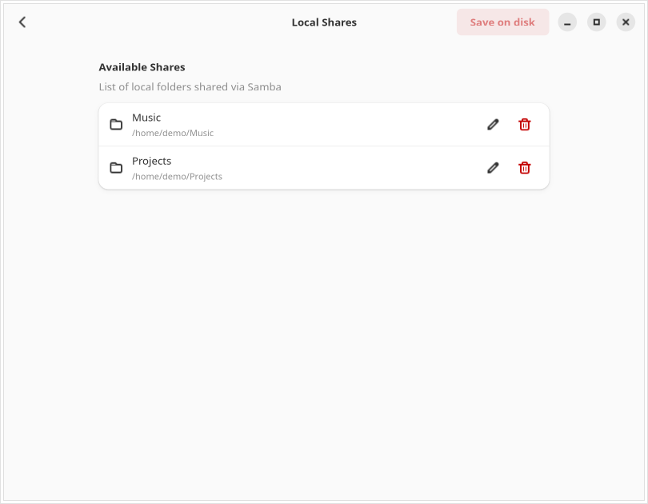
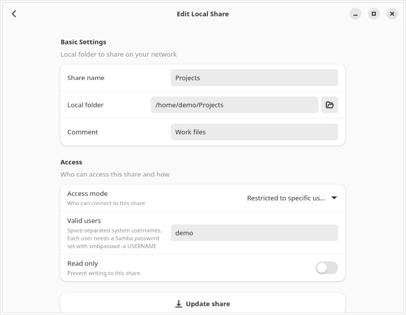
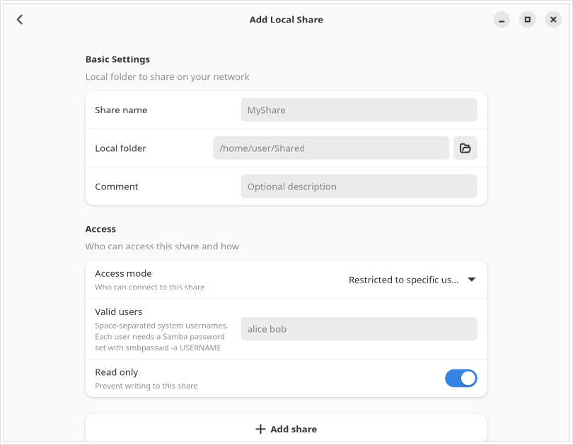

# GLF OS Nix Samba

Graphical tool for [GLF OS](https://github.com/Gaming-Linux-FR/GLF-OS) (a Linux distribution based on NixOS) to manage Samba shares without editing Nix files by hand.

Built with Python, GTK4 and Libadwaita. Available in English and French.



## Features

- **Remote shares (CIFS client)**: mount network shares from a NAS or another computer
  - list, add, edit and delete mount points
  - credentials file, UID/GID, systemd automount and timeouts
  - bookmark in the file manager (GTK or KDE) and optional desktop shortcut
- **Credentials file**: create a Samba credentials file (`chmod 600`)
- **Local shares (Samba server)**: share a local folder on your network
  - public access (guest) or restricted to specific users
  - read-only or read/write
- **Save and rebuild**: writes the NixOS configuration and runs `nixos-rebuild switch` in a terminal
- **Configuration check**: detects missing imports in `/etc/nixos/customConfig/default.nix` and offers to fix them

## Screenshots

### Remote shares

| List | Edit |
| --- | --- |
|  |  |

| Add | Credentials file |
| --- | --- |
|  |  |

### Local shares

| List | Edit |
| --- | --- |
|  |  |



## How it works

Changes are kept in memory until you click **Save on disk**. The application then:

1. generates the Nix modules:
   - `/etc/nixos/customConfig/samba.nix`: remote shares (`fileSystems`)
   - `/etc/nixos/customConfig/samba-server.nix`: local shares (`services.samba`)
2. checks that `/etc/nixos/customConfig/default.nix` imports `samba.nix`, `samba_setup.nix` (cifs-utils and the `mount.cifs` wrapper) and `samba-server.nix` as needed. If an import is missing, it asks for your password to add it.
3. opens a terminal that moves the files into place and runs `sudo nixos-rebuild switch`.

If you close the window with unsaved changes, the application asks for confirmation.

## Development

### On Linux with Nix

```bash
nix develop
python src/main.py
```

### On Linux with Docker

Only once:

```bash
./buildDocker.sh
```

Then:

```bash
./runWithDocker.sh
```

### Localization

```bash
xgettext -d base -o src/infrastructure/locales/nix-samba.pot src/main.py
```

Translations are in `src/infrastructure/locales/` (`en`, `fr`).

### Tests

```bash
python -m unittest discover -s tests/domain -p '*_test.py'
```

## Generate the sha256 for GLF OS

```bash
./getGlfSha256.sh X.Y.Z
```

## License

See [LICENSE](LICENSE).
